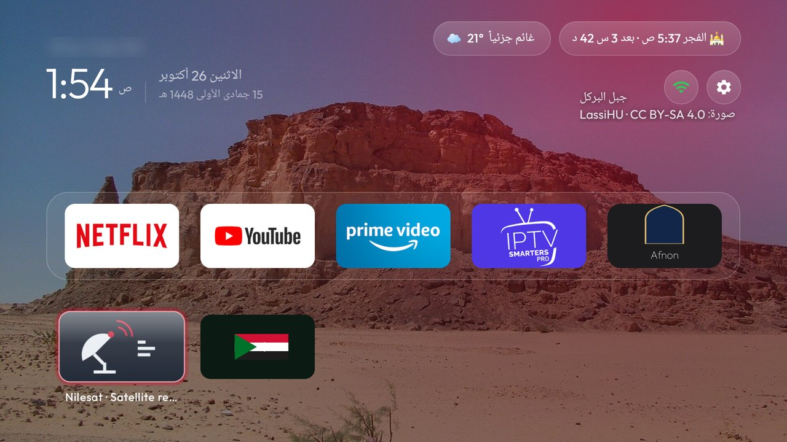

# Satellite

One tile that switches the TV to the satellite receiver's HDMI port. Most homes have a receiver on
HDMI, and the people who use it should not have to know which port, which remote or which menu: one
tile on Home, named after the receiver (`Nilesat` out of the box, in Arabic `نايل سات`), and OK
switches the TV to it. Nothing opens, nothing stays running: the activity asks the TV to show the
port and ends.



Out of the box the tile opens the first HDMI port with something connected, else HDMI 1. Pin a port
in `app/src/main/res/values/config.xml` before the build: a number (`2`), the port's label
(`HDMI 2`), the end of its input id (`HW2`), the name the receiver reports over HDMI-CEC or the name
the port was given in the TV's input settings (a device's own name wins over its port, so opening it
also wakes the receiver over CEC). The tile's name is `app_name` in `res/values/strings.xml` and
`res/values-ar/strings.xml`; the launcher card's label and caption are in `res/xml/module_card.xml`.

## Permissions

None. It reads the TV's input list through `TvInputManager`, which needs no permission; package
visibility is limited to TV input services (`<queries>` in the manifest). No network, no storage,
no background work.

## Build and install

```sh
cd addons/satellite
./gradlew assembleRelease
adb -s <tv ip>:5555 install -r app/build/outputs/apk/release/app-release.apk
```

JVM tests for the port rule: `./gradlew testReleaseUnitTest`. Needs a JDK 17 and the Android SDK
(`ANDROID_HOME`), like the other add-ons.

## Limits

- The TV must expose its HDMI ports as TV inputs, as Android TV sets do. A streaming stick has no
  HDMI input and Fire OS gives apps no HDMI-CEC "switch to that port" command either, so on a stick
  the tile only says so; pick the receiver with the TV's own Input button, or use a Fire TV Cube.
- Which app shows the port is the TV's choice, as with the launcher's Inputs pill. When two apps
  claim the input URI the TV shows a chooser; set `live_tv_package` in `config.xml` to the TV's own
  input app to skip it.
- The receiver itself is not controlled: the tile shows its port and that is all. If it sleeps,
  its own remote or HDMI-CEC wake-up from the TV brings it back.

## Tested on

- Amazon Fire TV Stick AFTMA08C15 (Fire OS 8, Android 11): the tile and its launcher card show up,
  and OK gives the "no HDMI inputs" message, since the stick has none.
- The switch itself has not yet run on a TV with HDMI inputs. The port rule is covered by the JVM
  tests; the intent is the one the launcher's Inputs pill and the Sources add-on use. Reports from
  an Android TV with a receiver are welcome.

## Maintainer

[@ZoolCoder](https://github.com/ZoolCoder)
